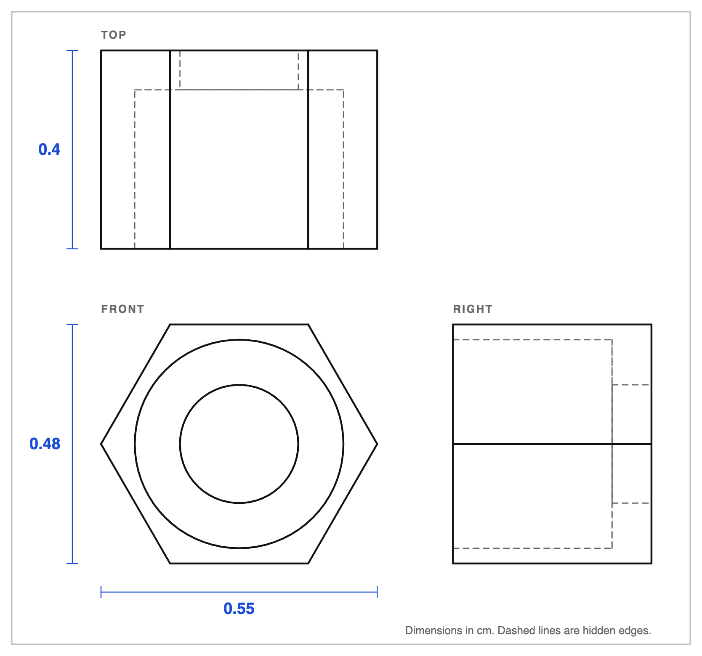
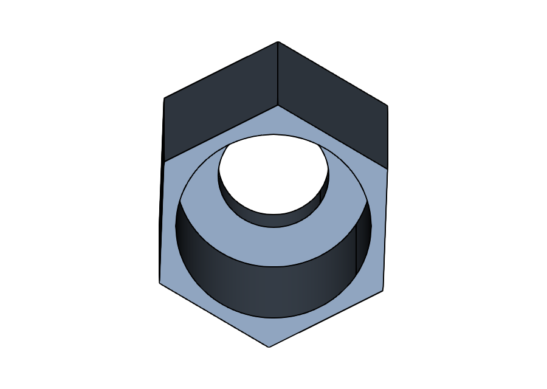

# drawing2brep

Engineers describe parts with flat technical drawings, but design software needs a 3D model that can be edited. This project turns a drawing of a part into an editable CAD program, checks the result against the true geometry, and (planned) lets you change it with requests like "make it 5 mm thicker". It is trained and tested on [Fusion 360 Gallery](https://github.com/AutodeskAILab/Fusion360GalleryDataset), Autodesk Research's dataset of real designs with their construction history.

> **Status:** in development. The dataset conversion and the geometric verifier are built and measured (see [Results so far](#results-so-far)). Drawing generation, baselines and training are not started. Results are added as they are measured.

## Example

One part from the dataset: a hex nut with a stepped hole (design `22430_c6f08b03_0029`).

**1. Input: a technical drawing of the part.** Front, top and right views, with hidden edges dashed and the overall dimensions marked.



**2. Output: a CadQuery program.** Step 1 draws a hexagon with a round hole and extrudes it. Step 2 cuts a wider, shallower hole into one end.

```python
import cadquery as cq

# Step 1: new body
plane_1 = cq.Plane(origin=(0.0, 0.0, 0.0), xDir=(1.0, 0.0, 0.0), normal=(0.0, 1.0, 0.0))
part_1 = (
    cq.Workplane(plane_1)
    .polyline([(-0.1378, -0.2388), (-0.2757, 0.0), (-0.1378, 0.2388), (0.1378, 0.2388), (0.2757, 0.0), (0.1378, -0.2388)]).close()
    .moveTo(0.0, 0.0).circle(0.1181)
    .extrude(0.3962)
)
result = part_1

# Step 2: cut
plane_2 = cq.Plane(origin=(0.0, 0.0, 0.0), xDir=(1.0, 0.0, 0.0), normal=(0.0, -1.0, 0.0))
part_2 = (
    cq.Workplane(plane_2)
    .moveTo(0.0, 0.0).circle(0.2083)
    .moveTo(0.0, 0.0).circle(0.1181)
    .extrude(-0.3175)
)
result = result.cut(part_2)
```

**3. Result: the part the program builds.** Running the program gives this solid, which matches the dataset's ground-truth solid with an IoU of 0.9997.



This shows the intended end-to-end result. The model is not trained yet: the program above is the verified label for this part, which is what the model will be trained to write when given the drawing.

## How it works

1. **Done.** Converts each dataset design into a CadQuery program and verifies it reproduces the original solid.
2. **Planned.** Produces every representation of each design with a Ray pipeline: orthographic drawing with hidden lines, mesh, point cloud, and B-Rep face-adjacency graph.
3. **Planned.** Fine-tunes a vision-language model to write the CadQuery program from the drawing.
4. **Planned.** Executes the generated program in a sandbox and measures the solid against the ground truth.

## Design

- **The output is a CadQuery program,** not a mesh. It is readable, editable, and runs without a CAD application.
- **Convert, then verify.** A converted program is kept only if its solid matches the original (IoU above 0.99). The yield is reported.
- **Official split.** The dataset's 6,900 training and 1,725 test designs. Only designs with a verified program are used (6,155 and 1,541), so test results are on that subset and are comparable with work that uses all 1,725.
- **Drawings carry overall dimensions.** Without them scale cannot be recovered. Metrics are reported both absolute and scale-normalised.
- **Baselines before training.** Off-the-shelf models are benchmarked first on the same test set.
- **Failure taxonomy.** Each failure is classed as wrong dimension, missing feature or invalid solid.

## Results so far

### Converter

The converter turns each design's recorded construction sequence into a CadQuery program. Each program is then executed and its solid is compared with the dataset's ground-truth solid. A program is kept only if the IoU is above 0.99. The code is in [`src/d2b/data/to_cadquery.py`](src/d2b/data/to_cadquery.py).

| Outcome | Designs | Share |
| --- | --- | --- |
| Verified (kept as a label) | 7,696 | 89.2% |
| Not supported by the converter | 755 | 8.8% |
| Program failed to execute | 80 | 0.9% |
| Executed, but the solid did not match | 59 | 0.7% |
| Executed, but the solid was invalid | 35 | 0.4% |
| **Total** | **8,625** | |

- **Split:** 6,155 of 6,900 training designs (89.2%) and 1,541 of 1,725 test designs (89.3%) are verified.
- **Supported:** lines, arcs and circles; holes; new body, join, cut and intersect; one-sided, symmetric and two-sided extrudes; offset starts; taper on one-sided extrudes.
- **Not supported:** splines and ellipses (540 designs), which is the main reason the yield is not higher.
- **Programs are short:** the median is 19 lines.

### Verifier

The verifier decides whether a program is correct. It compares the solid the program builds with the dataset's ground-truth solid and reports their IoU: the volume they share divided by the volume they cover together, where 1 means identical. It filters the converted programs above, and it will score the model's programs later. The code is in [`src/d2b/eval/geometry.py`](src/d2b/eval/geometry.py).

Measuring IoU reliably needed one fix. A single boolean operation sometimes reported zero overlap for two identical solids. The shared volume is now measured two independent ways (boolean intersection and boolean union) and accepted only if they agree to within 0.1%; otherwise IoU is estimated from 20,000 sampled points. Of the 7,696 verified designs, 466 were scored by sampling.

### Model results (not measured yet)

| Model | Valid solid | Mean IoU | IoU > 0.9 | Chamfer distance | Volume error |
| --- | --- | --- | --- | --- | --- |
| Frontier model, zero-shot | | | | | |
| Qwen2.5-VL, zero-shot | | | | | |
| Qwen2.5-VL, fine-tuned | | | | | |
| + GRPO with geometric reward | | | | | |
| + repair loop | | | | | |

## Roadmap

MVP

- [x] Sequence-to-CadQuery converter with verification
- [ ] Ray pipeline for drawings, meshes, point clouds and B-Rep graphs
- [ ] Geometric evaluator (validity, volume error and IoU done; Chamfer distance and face and edge counts to do)
- [ ] Zero-shot baselines
- [ ] LoRA fine-tune
- [ ] Failure taxonomy
- [ ] Demo: upload a drawing, see the solid

After the MVP

- [ ] Full test set and few-shot baselines
- [ ] GRPO with a geometric reward
- [ ] Execute, check, repair loop
- [ ] UV-Net-style B-Rep encoder for retrieval and similarity scoring
- [ ] WebGL viewer with MCP tools for natural-language edits, with approval before each change
- [ ] Round trip through Fusion 360's Python API
- [ ] Released benchmark

## Quickstart

Requires [uv](https://docs.astral.sh/uv/). The environment uses Python 3.12.

```bash
uv sync
uv run pytest
```

To reproduce the conversion results, download the Fusion 360 Gallery reconstruction dataset (r1.0.1) from the [dataset repository](https://github.com/AutodeskAILab/Fusion360GalleryDataset) and extract it to `data/raw/r1.0.1/`. Then:

```bash
uv run python -m d2b.data.verify                   # all 8,625 designs, about 13 minutes on 10 cores
uv run python -m d2b.data.verify --subset single   # single-extrude designs only
```

The script, [`src/d2b/data/verify.py`](src/d2b/data/verify.py), prints the yield and a breakdown of failures, and writes one record per design, including the generated program, to `outputs/verify.jsonl`.

## Data and licence

The dataset is not included in this repository. It is released by Autodesk under the Fusion 360 Gallery Dataset License, which permits non-commercial research use only.
